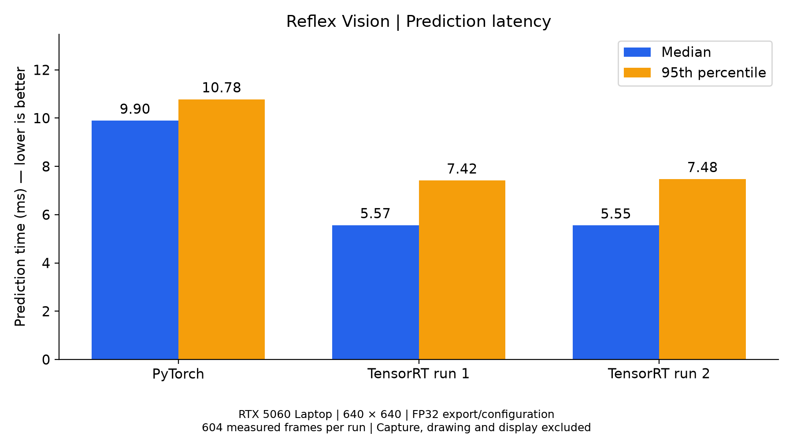
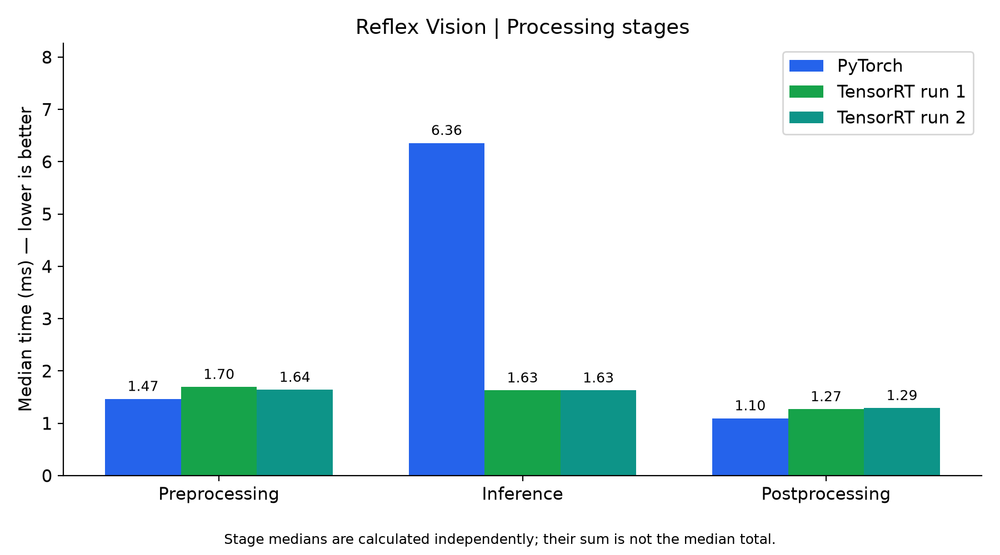

# Reflex Vision

### What actually changes when I run the same object detector through TensorRT?



I started this project because I wanted to do more than run a pretrained model and watch boxes appear around things on my screen. I was curious about the part *after* training: how much of a difference does the inference backend make, and does a faster result still give you the same detections?

So I took **YOLO26n**, ran it on my **RTX 5060 Laptop GPU**, and compared **PyTorch** with **NVIDIA TensorRT** using the same recorded video. I wrote the video loop, GPU timing/logging code, comparison scripts, and charts. **I did not train the model.**

## The result that made this worth doing

At a 640 × 640 input size, these were my FP32-configured runs:

| Backend | Median prediction | 95th percentile | Median model inference |
| --- | ---: | ---: | ---: |
| PyTorch | 9.90 ms | 10.78 ms | 6.36 ms |
| TensorRT, run 1 | 5.57 ms | 7.42 ms | 1.63 ms |
| TensorRT, run 2 | 5.55 ms | 7.48 ms | 1.63 ms |

That's roughly **44% lower median prediction latency** (or **1.78× faster**) in this setup. The model-inference stage alone dropped from about 6.36 ms to 1.63 ms.



The first number was exciting, but it also made me ask another question: **did speeding it up change what the model saw?**

## Faster is nice. But are the detections the same?

I ran both backends across **634 readable frames** and matched their predicted boxes by class and intersection-over-union (IoU).

- PyTorch: **959** detections
- TensorRT: **961** detections
- Matched pairs: **959**
- Median box IoU among matches: **0.9998**
- Additional TensorRT detections: **2**

I looked at those two extra detections manually. In one frame, TensorRT called part of a wall a refrigerator. In another, it picked up a chair PyTorch didn't flag. Both were right around the **0.25 confidence threshold**.

That was probably the most interesting part of this project for me. Two runs can agree almost perfectly and *still* behave differently at the edge of a confidence cutoff. I can't say exactly what caused those differences, and agreement with PyTorch isn't the same thing as ground-truth accuracy.

## How I measured it

I wanted a comparison I could inspect later, not just a single FPS number.

I used the same saved video, batch size 1, a fixed 640 × 640 input, and **30 warm-up frames** followed by **604 measured frames** per benchmark run. The script synchronizes CUDA around the prediction call and saves per-frame timings to CSV. I also recorded preprocessing, inference, and postprocessing times separately.

One important detail: the reported prediction time **doesn't include video decoding, drawing boxes, or displaying frames**. It's not camera-to-screen latency or whole-app FPS. And the FP32 label is the selected configuration/export, not a promise about every internal GPU instruction.

I also tried smaller inputs and PyTorch FP16. Smaller frames helped only a little in my early tests, and the PyTorch FP16 run didn't beat the FP32 baseline. An attempt to build a TensorRT FP16 engine ended in a Windows display-driver crash (bugcheck 0x116). I didn't establish the cause, so I left that experiment unfinished rather than reporting a result I couldn't reproduce.

## Try it yourself

The project was developed on Windows with **Python 3.12.10**, **PyTorch 2.7.1+cu128**, **TensorRT 10.13**, **Ultralytics 8.4.177**, and an **RTX 5060 Laptop GPU**. Exact versions are in [requirements-lock.txt](requirements-lock.txt).

```bat
git clone https://github.com/adhyayan15/reflex-vision.git
cd reflex-vision

py -3.12 -m venv .venv
.venv\Scripts\activate
python -m pip install --upgrade pip
python -m pip install torch==2.7.1 torchvision==0.22.1 --index-url https://download.pytorch.org/whl/cu128
python -m pip install -r requirements-lock.txt
```

The benchmark video and model files are **not included in this repository**. Put your own `test_video.mp4` in the root and obtain the pretrained `yolo26n.pt` model through Ultralytics. To compare with TensorRT, export a compatible 640 × 640, batch-1 engine on your machine.

In [reflex_vision.py](reflex_vision.py), set `MODEL` to `"yolo26n.pt"` for PyTorch or to your TensorRT engine filename. Then run:

```bat
python reflex_vision.py
```

For the detection comparison, point the `trt_model` path in [compare_detections.py](compare_detections.py) to your exported engine:

```bat
python compare_detections.py
python plot_results.py
```

The plotting script uses specific saved CSV filenames from my runs; change its `FILES` mapping if you want to plot your own measurements.

You can browse the [raw timing CSVs](results/), [comparison output](results/agreement_20261015_014351/frame_summary.csv), and [charts](results/charts/) without a GPU.

## Where I'd take this next

I want to test more scenes, repeat runs under controlled GPU temperatures/power modes, and check detections against a labeled dataset. Right now these are **single-device benchmark observations**, not universal TensorRT performance claims.

The big thing I learned was to measure *both* speed and output agreement. An optimization isn't especially useful if I can't explain what I measured or what changed.

Built by **Adhyayan Tiwari**. YOLO26n and the model interface come from **Ultralytics**; execution uses PyTorch/CUDA and NVIDIA TensorRT. See those projects for their respective licensing terms.
